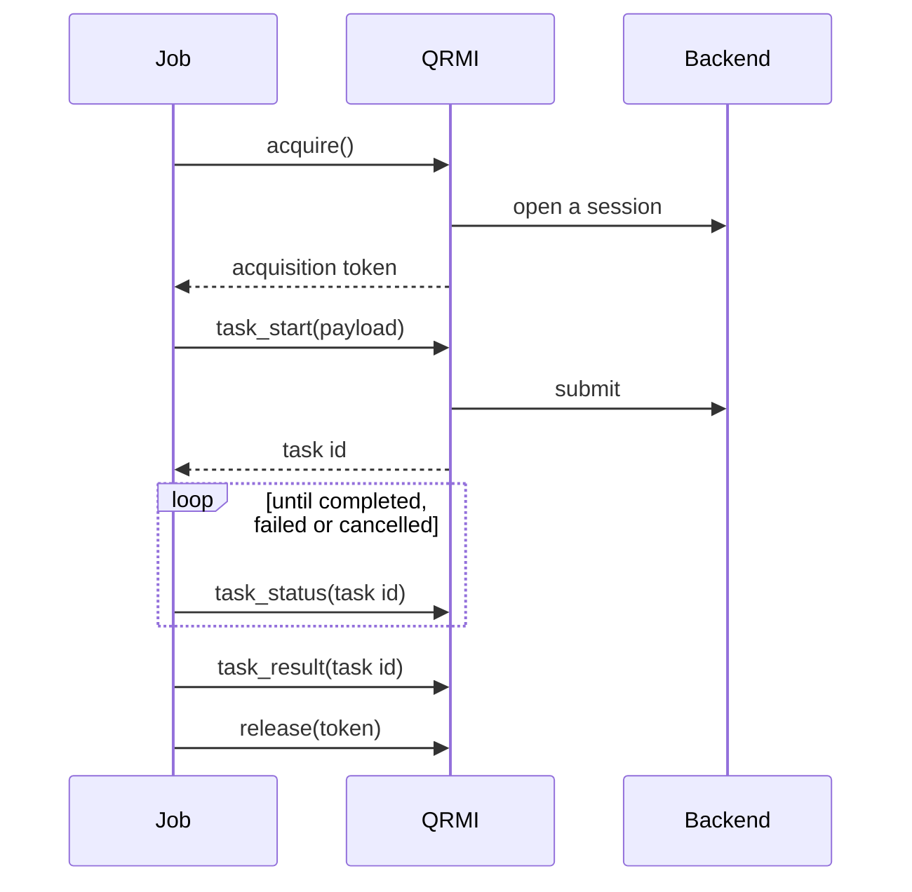

<!-- Draft reference post: shows every blog feature. Build it with `hugo server -D`. -->

Every QRMI resource, whatever the vendor, goes through the same lifecycle:
acquire it, start a task, poll the task until it ends, read the result and
release the resource. This post shows that lifecycle once as a diagram, then in
each language that can call QRMI.

## The lifecycle



## Some maths

A Pulser sequence on a neutral-atom device drives the atoms with the Hamiltonian
(with $\hbar = 1$ and the phase set to zero)

$$
H(t) = \sum_i \left( \frac{\Omega(t)}{2} \sigma_i^x - \delta(t)\, n_i \right)
     + \sum_{i<j} \frac{C_6}{R_{ij}^6}\, n_i n_j ,
$$

where $\Omega(t)$ is the Rabi frequency, $\delta(t)$ the detuning and $R_{ij}$
the distance between atoms $i$ and $j$. A task with $N$ shots (`job_runs`)
estimates the probability $p$ of a bitstring with standard error
$\sqrt{p(1-p)/N}$, so 100 shots give at best about $\pm 5\%$.

## Python

```python {hl_lines=[7]}
import time

from qrmi import Payload, QuantumResource, ResourceType, TaskStatus

qrmi = QuantumResource("EMU_FREE", ResourceType.PasqalCloud)
token = qrmi.acquire()
task_id = qrmi.task_start(Payload.PasqalCloud(sequence=sequence, job_runs=100))
done = (TaskStatus.Completed, TaskStatus.Failed, TaskStatus.Cancelled)
while qrmi.task_status(task_id) not in done:
    time.sleep(1)
print(qrmi.task_result(task_id).value)
qrmi.release(token)
```

## Rust

```rust {title="src/main.rs" linenos=true}
let mut qrmi = PasqalCloud::new("EMU_FREE")?;
let token = qrmi.acquire().await?;
let task_id = qrmi
    .task_start(Payload::PasqalCloud { sequence, job_runs: 100 })
    .await?;
loop {
    match qrmi.task_status(&task_id).await? {
        TaskStatus::Completed => {
            println!("{}", qrmi.task_result(&task_id).await?.value);
            break;
        }
        TaskStatus::Failed | TaskStatus::Cancelled => {
            println!("{}", qrmi.task_logs(&task_id).await?);
            break;
        }
        _ => tokio::time::sleep(Duration::from_secs(1)).await,
    }
}
qrmi.release(&token).await?;
```

## C

```c
QrmiQuantumResource *qrmi =
    qrmi_resource_new("EMU_FREE", QRMI_RESOURCE_TYPE_PASQAL_CLOUD);
char *token = NULL, *task_id = NULL, *result = NULL;
qrmi_resource_acquire(qrmi, &token);

QrmiPayload payload = {.tag = QRMI_PAYLOAD_PASQAL_CLOUD};
payload.PASQAL_CLOUD.sequence = sequence;
payload.PASQAL_CLOUD.job_runs = 100;
qrmi_resource_task_start(qrmi, &payload, &task_id);

QrmiTaskStatus status;
do {
  sleep(1);
  qrmi_resource_task_status(qrmi, task_id, &status);
} while (status == QRMI_TASK_STATUS_QUEUED || status == QRMI_TASK_STATUS_RUNNING);

if (status == QRMI_TASK_STATUS_COMPLETED &&
    qrmi_resource_task_result(qrmi, task_id, &result) == QRMI_RETURN_CODE_SUCCESS) {
  printf("%s\n", result);
  qrmi_string_free(result);
}
qrmi_string_free(task_id);
qrmi_resource_release(qrmi, token);
qrmi_string_free(token);
qrmi_resource_free(qrmi);
```

## C++

C++ calls the same C API; `std::unique_ptr` frees the handle and strings.

```cpp
#include <iostream>
#include <memory>
#include <stdexcept>

#include "qrmi.h"

struct QrmiFree {
  void operator()(QrmiQuantumResource *r) const { qrmi_resource_free(r); }
  void operator()(char *s) const { qrmi_string_free(s); }
};
using Resource = std::unique_ptr<QrmiQuantumResource, QrmiFree>;
using String = std::unique_ptr<char, QrmiFree>;

String acquire(const Resource &qrmi) {
  char *token = nullptr;
  if (qrmi_resource_acquire(qrmi.get(), &token) != QRMI_RETURN_CODE_SUCCESS)
    throw std::runtime_error(
        String(const_cast<char *>(qrmi_get_last_error())).get());
  return String(token);
}

int main() {
  Resource qrmi(qrmi_resource_new("EMU_FREE", QRMI_RESOURCE_TYPE_PASQAL_CLOUD));
  String token = acquire(qrmi);
  std::cout << "acquired " << token.get() << '\n';
  qrmi_resource_release(qrmi.get(), token.get());
}
```

## Lua

```lua
local qrmi = require("qrmi")

local resource = assert(qrmi.new("EMU_FREE", "pasqal-cloud"))
assert(resource:acquire())
local task_id = assert(resource:task_start({
    pasqal_cloud = { sequence = sequence, job_runs = 100 },
}))

local done = { completed = true, failed = true, cancelled = true }
local status = resource:task_status(task_id)
while not done[status] do
    os.execute("sleep 1")
    status = resource:task_status(task_id)
end
print(resource:task_result(task_id))
resource:release()
resource:free()
```

## Go

The [qrmi-go](https://github.com/converged-computing/qrmi-go) bindings submit
Qiskit primitives, so this example runs a sampler on an IBM backend.

```go
r, err := qrmi.New("ibm_fez", qrmi.QiskitRuntimeService)
if err != nil {
	log.Fatal(err)
}
defer r.Close()

token, err := r.Acquire()
if err != nil {
	log.Fatal(err)
}
defer r.Release(token)

taskID, err := r.TaskStart(qrmi.QiskitPrimitive{Input: input, ProgramID: "sampler"})
if err != nil {
	log.Fatal(err)
}
for {
	status, err := r.TaskStatus(taskID)
	if err != nil {
		log.Fatal(err)
	}
	if status.IsTerminal() {
		break
	}
	time.Sleep(time.Second)
}
result, err := r.TaskResult(taskID)
```

## Shell

```bash
sbatch --qpu=EMU_FREE job.sh
```
